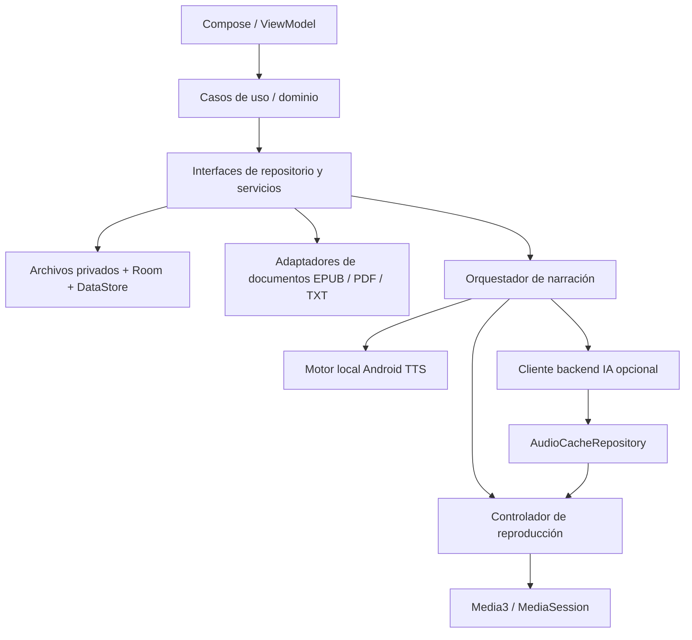

# LECTOR IA — DOCUMENTO MAESTRO DE DESARROLLO

**Identificador:** LIA-MASTER-001  
**Versión:** 1.0 — especificación de arranque  
**Fecha:** 23 de noviembre de 2026  
**Estado:** Arquitectura acordada; implementación **NO iniciada**  
**Plataforma:** Android nativo  
**Tecnologías principales:** Kotlin, Jetpack Compose, Material 3, Room, Readium, Android TextToSpeech y Media3  
**Repositorio propuesto:** `LectorIA-Android`  
**Propósito del documento:** fuente de verdad para planificación, implementación, pruebas y revisión de cambios con Codex.

> **Regla de lectura:** lo marcado **DECIDIDO** procede de las decisiones de producto conversadas. Lo marcado **PROPUESTO** requiere una validación técnica antes de fijar dependencias o implementaciones. Ningún punto de este documento implica que una funcionalidad ya exista.

---

## 1. Visión del producto

Crear una aplicación Android que transforme archivos **EPUB, PDF y TXT** en una experiencia de lectura y escucha accesible, agradable y natural. Debe funcionar **offline-first**, ofrecer **TTS local gratuito**, permitir **narración IA en la nube como opción voluntaria** y conservar el audio generado para reproducirlo posteriormente sin conexión, sujeto a las condiciones del proveedor y a los derechos aplicables.

### 1.1 Principios no negociables — DECIDIDO

1. **Producto real, no prototipo engañoso.** Nada de datos simulados presentados como reales, botones inertes o pantallas declaradas completas sin lógica funcional.
2. **Offline-first.** Importar/abrir libros ya guardados, leer texto, consultar progreso y narrar mediante voces locales instaladas debe funcionar sin conexión.
3. **Motor híbrido.** Un sistema de reproducción común abstrae un motor TTS local y un proveedor IA opcional. Ninguno debe imponer dependencias a la biblioteca.
4. **Protección del usuario y sus archivos.** No borrar libros ni progreso por fallas de parsing, actualización, caché o generación de audio.
5. **Costo controlado.** Nunca iniciar consumos de API facturables sin consentimiento informado y límites. No almacenar claves privadas en APK, recursos, `BuildConfig` ni Git.
6. **UI moderna y usable.** Base visual «tormenta medianoche» y Glass sutil, con legibilidad alta en textos largos; la estética nunca compromete accesibilidad.
7. **Cambios incrementales.** Rama por bloque, compilación y pruebas después de cada cambio importante; informes de resultado con hechos, no afirmaciones sin ejecutar.
8. **Privacidad.** Los documentos importados permanecen locales por defecto. El envío de contenido a un servicio externo requiere aceptación expresa.
9. **Sin evasión de DRM.** En la primera versión se admiten documentos propios o de uso autorizado y sin DRM; mostrar un error comprensible para archivos protegidos/no compatibles.
10. **Separación de responsabilidades.** Parser, biblioteca, narración, reproducción, persistencia, red y UI no se acoplan entre sí.

### 1.2 Usuarios y escenario principal

Usuario Android que tiene libros académicos, novelas, apuntes y documentos en PDF/EPUB/TXT y desea escucharlos durante desplazamientos, con pantalla apagada y controles Bluetooth, sin pagar por cada minuto de voz local. Opcionalmente puede escoger una voz neuronal más natural para algunos capítulos y reutilizar después su audio descargado.

### 1.3 Restricciones iniciales

- Priorizar Android 16 en dispositivo físico Samsung Galaxy S22+ como primer entorno de prueba; mantener compatibilidad con una gama razonable de Android tras validar dependencias.
- No se necesita registro de cuenta ni backend para leer o usar TTS local.
- El servicio cloud **no se incorpora realmente** hasta que existan credenciales, cuotas y configuración segura de backend. La UI debe indicar honestamente «no disponible/configurado» hasta entonces.
- No copiar lógica de Copiloto Moto a ciegas. Solo reutilizar patrones arquitectónicos comprobados de audio, Bluetooth, MediaSession y pruebas cuando sean pertinentes.

---

## 2. Alcance de producto

### 2.1 Objetivos funcionales del MVP — DECIDIDO

**Biblioteca**

- [ ] Importar EPUB, PDF y TXT mediante Android Storage Access Framework.
- [ ] Copiar los originales a almacenamiento privado y registrar metadata persistente (título, autor cuando exista, formato, tamaño, portada si es obtenible).
- [ ] Listar, abrir y eliminar libros; confirmación separada entre borrar libro y borrar solamente audio caché.
- [ ] Conservar avance de lectura y última ubicación; sobrevivir reinicios y cierres forzados.

**Lector**

- [ ] Mostrar EPUB y PDF; presentar TXT de modo legible.
- [ ] Extraer texto narrable en EPUB/TXT y en PDFs con capa de texto cuando la librería elegida realmente lo soporte.
- [ ] Identificar capítulos o secciones cuando existan; definir fragmentación alternativa para documentos sin índice.
- [ ] Guardar y restaurar ubicación de lectura específica por formato.

**Narración local**

- [ ] Enumerar voces y motores Android TTS realmente disponibles e identificar cuáles requieren red.
- [ ] Seleccionar voz, idioma, velocidad; reproducir, detener, avanzar y reanudar **con la precisión viable del motor**.
- [ ] Preservar posición a través de límites de frases/chunks.
- [ ] Informar cuando no exista una voz offline instalada o el motor TTS falle.

**Narración IA opcional**

- [ ] Conectar **un** proveedor real tras crear backend seguro.
- [ ] Solicitar generación por fragmento/capítulo, estimar costo o créditos cuando sea posible y requerir aprobación del usuario.
- [ ] Guardar archivos de audio y reproducirlos offline; evitar llamadas duplicadas para un mismo resultado válido.
- [ ] Permitir cambiar al motor local ante error, límite de cuota o desconexión.

**Reproducción e integración Android**

- [ ] Audio con pantalla apagada, notificación multimedia, audio focus y controles por Bluetooth.
- [ ] Reanudar con seguridad tras interrupciones de llamada/audio focus, sin reproducción simultánea no deseada.
- [ ] Mostrar espacio usado por caché y permitir limpieza controlada sin afectar originales/progreso.

### 2.2 Fuera de alcance del primer MVP — DECIDIDO

OCR avanzado de PDF escaneado, clonación de voz, narración con múltiples personajes, traducción automática, sincronización cloud entre teléfonos, compras/tienda, bibliotecas DRM protegidas, resaltado palabra a palabra exacto en todos los formatos y IA que «actúe» diálogos con garantía de emoción. Quedan para evaluación futura, no como prestaciones prometidas.

### 2.3 Distinciones importantes

- **Voz natural** es el objetivo de experiencia; **TTS local** no equivale automáticamente a voz humana expresiva. La calidad depende de motor e idioma instalados.
- **Modo offline** significa reproducir documentos y narraciones locales disponibles. **Generar IA** requiere conexión salvo que en el futuro adoptemos un modelo on-device viable.
- **Leer PDF** no garantiza **extraer su texto**. El renderizador y el extractor son responsabilidades distintas. Los PDF que sean solo imágenes requieren OCR, fuera del MVP básico.
- Android `TextToSpeech` no ofrece controles de pausa/seek idénticos a ExoPlayer: el adaptador local utilizará fragmentos, callbacks de progreso y recuperación aproximada desde un límite de texto consistente. No prometer seek por milisegundos para voz local.

---

## 3. Stack técnico y decisiones de ingeniería

| Responsabilidad | Elección | Estado / cautela |
|---|---|---|
| Lenguaje | Kotlin | DECIDIDO |
| UI | Jetpack Compose + Material 3 | DECIDIDO |
| Patrón | MVVM + separación de dominio / repositorios | DECIDIDO |
| Asincronía | Coroutines + StateFlow/Flow | PROPUESTO, recomendado |
| DI | Hilt | DECIDIDO en v1.0; validar integración |
| EPUB | Readium Kotlin Toolkit | DECIDIDO como candidato base; validar ejemplo real antes de fijar módulos |
| PDF UI | Readium PDF navigator o PdfRenderer | PROPUESTO; spike obligatorio |
| Extracción PDF | Adaptador dedicado validado por pruebas con PDF de capa textual | PENDIENTE; `PdfRenderer` por sí solo no implica extracción |
| TXT | lector propio con detección segura de codificación | PROPUESTO |
| TTS local | Android `TextToSpeech` y/o adaptador Readium TTS | DECIDIDO; comparar integración real |
| IA | `CloudNarrationProvider` desacoplado + backend privado | DECIDIDO; proveedor inicial candidato ElevenLabs |
| Audio archivo | Media3 ExoPlayer | DECIDIDO |
| Segundo plano | Media3 `MediaSessionService` para audio de archivos; validar integración del TTS en su propio controlador | PROPUESTO de implementación |
| Base de datos | Room | DECIDIDO |
| Preferencias | DataStore | DECIDIDO |
| Procesos diferidos | WorkManager | DECIDIDO para trabajos persistentes y reintentos compatibles |
| Archivos | app-private storage + Storage Access Framework | PROPUESTO |
| Pruebas | JUnit, pruebas Android instrumentadas, pruebas manuales físicas | DECIDIDO como estrategia |

**Versiones de dependencias:** usar versiones estables compatibles confirmadas al arrancar implementación; registrar la matriz Kotlin/AGP/Gradle/Compose/Readium. No pegar versiones inventadas ni usar `+` dinámico. Readium Kotlin 3.4.0 es una referencia comprobada en noviembre de 2026; validar la última estable en el momento de implementación.

**API Android mínima:** definir después del spike de dependencias. Readium Kotlin 3.4.0 exige Android API 24 como mínimo, pero eso no obliga a adoptar exactamente `minSdk=24`; se puede escoger uno superior con justificación.

### 3.1 Fuentes oficiales de validación

- Readium Kotlin Toolkit: https://readium.org/kotlin-toolkit/3.4.0/
- Readium release 3.4.0: https://blog.readium.org/release-note-kotlin-toolkit-version-3-4-0/
- Readium TTS (revisar la versión correspondiente): https://readium.org/kotlin-toolkit/3.1.2/guides/tts/
- Media3 segundo plano: https://developer.android.com/media/media3/session/background-playback
- Android PdfRenderer: https://developer.android.com/reference/android/graphics/pdf/PdfRenderer
- ElevenLabs API: https://elevenlabs.io/docs/eleven-api/quickstart/

---

## 4. Arquitectura lógica

### 4.1 Capas



**Reglas de dependencias:** UI conoce casos de uso, pero no sabe cómo se extrae un EPUB o cómo se invoca una API; dominio define contratos sin depender del SDK Android; adapters dependen del dominio y encapsulan frameworks. Ninguna pantalla accede directamente a Room o a un SDK cloud.

### 4.2 Contratos a definir antes de implementar motores

- `BookRepository`: importar/listar/obtener/eliminar libros, transiciones de estado, metadata.
- `DocumentReader`: abrir un libro, enumerar secciones, entregar fragmentos narrables, traducir locators.
- `ReadingProgressRepository`: guardar/cargar última posición y granularidad soportada.
- `NarrationEngine`: seleccionar voz, preparar texto, producir eventos de progreso/errores, cancelar; el contrato distingue `LiveSpeech` de `AudioFile`.
- `NarrationCoordinator`: decide modo local/cloud, trata interrupciones y garantiza un solo reproductor activo.
- `AudioPlaybackController`: reproducir archivos descargados, estado, metadatos, notificación y MediaSession.
- `AudioCacheRepository`: buscar por identidad de contenido/configuración, guardar atómicamente, validar integridad, limpiar.
- `CloudNarrationGateway`: interfaz de llamadas autenticadas al backend; **nunca** se introduce un secreto de proveedor en cliente.

**No forzar un único `seekTo(milliseconds)` para todos los motores.** Distinguir `TextLocator` (EPUB/TXT y PDF textual si aplicable) de `MediaPositionMs` (audio ya generado).

### 4.3 Modelo de datos inicial — esquema conceptual

| Entidad | Campos sugeridos | Integridad |
|---|---|---|
| `Book` | `id`, `title`, `author?`, `format`, `contentHash`, `localPath`, `importState`, `createdAt` | UID único; archivo verificado antes de READY |
| `Section` | `id`, `bookId`, `order`, `title?`, `locatorStart`, `locatorEnd?` | FK y orden estable |
| `ReadingProgress` | `bookId`, `locator`, `updatedAt`, `lastNarrationMode` | Persistir por documento, no por pantalla |
| `NarrationJob` | `id`, `bookId`, `sectionId`, `provider`, `state`, `attempt`, `requestedAt`, `lastError?` | estados explícitos; sin doble cobro por reintento ciego |
| `AudioCacheEntry` | `cacheKey`, `bookId`, `sectionId`, `voiceId`, `modelId`, `settingsHash`, `filePath`, `bytes`, `checksum`, `state` | reproducir solo estado VALID |
| `AppSettings` | tema, voz seleccionada, velocidad, confirmaciones/costos, límite de caché | DataStore |

Los esquemas definitivos deberán cubrir migraciones Room y relaciones; no hay todavía BD implementada.

### 4.4 Importación segura y recuperación

1. Elegir archivo con Storage Access Framework (sin pedir permisos de almacenamiento general innecesarios).
2. Validar encabezado/extensión/MIME de manera razonable; limitar tamaño inicial, protegerse contra EPUB ZIP malicioso y directorios de extracción inseguros.
3. Copiar a archivo temporal privado, calcular hash y comprobar integridad; identificar duplicados.
4. Extraer metadata y probar apertura antes de marcar `READY`.
5. Publicar el archivo con renombrado seguro y finalizar registro; si un paso falla, mostrar error recuperable sin afectar otros libros.
6. Al iniciar app, reconciliar importaciones interrumpidas y archivos huérfanos sin eliminación automática de originales válidos.
7. Al borrar, solicitar confirmación explícita y distinguir libro original, progreso y caché.

El filesystem y Room no comparten una transacción atómica; implementar protocolo de estados y recuperación, no asumir lo contrario.

### 4.5 Caché de narración IA

- Unidad inicial: **fragmento manejable**; agrupar por capítulo para UX, no pedir de golpe un libro entero.
- Identidad: SHA-256 de texto normalizado + versión de normalización + proveedor/modelo/voz/parámetros; asociar también a libro/sección para navegación.
- Generar a temporal, verificar respuesta/duración/archivo y mover a ubicación final antes de marcar caché `VALID`.
- Si está `VALID`, reproducir sin solicitud de red. Si está corrupto, marcar fallo y ofrecer regeneración con aprobación cuando implique costo.
- Definir cuota máxima del usuario, limpieza LRU y excepción para descargas fijadas; **nunca** borrar los libros al limpiar caché.
- Respetar permisos de retención y uso del audio de cada proveedor; no asumir que toda voz permite almacenamiento indefinido.
- Reintentos con idempotencia/correlación y control de costos para evitar facturación repetida ante timeout.

### 4.6 Seguridad, red y privacidad

- El backend es opcional y aparece solo en Fase D; el MVP local no depende de su disponibilidad.
- Exigir TLS, claves en secretos de servidor, autenticación y autorización, cuotas por usuario/instalación y rate limiting.
- Informar antes de subir texto a un tercero: proveedor, qué texto se enviará y posible consumo.
- No subir un libro entero si basta el fragmento solicitado.
- No escribir texto de libros, tokens, credenciales o audios sensibles en logs de producción.
- Sin analíticas invasivas por defecto. Definir política de privacidad antes de una publicación pública.
- No usar credenciales reales de producción para tests ni confirmación de costos simulada.

---

## 5. Diseño de UI / UX

### 5.1 Identidad — DECIDIDO

**Actualización autorizada por el usuario, 24/11/2026:** la versión 0.5.0 adopta
un diseño oscuro minimalista neutro, con texto marfil y acento cálido discreto.
Los tokens azules siguientes quedan como referencia histórica de arranque.
Se añade seguimiento del rango narrado según callbacks reales del TTS, sin
prometer exactitud palabra a palabra en todos los motores ni sobre imágenes PDF.
Perfiles locales de tono/ritmo/pausa amplían los ajustes; la narración IA cloud
continúa fuera de esta entrega. Detalle: ADR-014 en `architecture.md`.

| Token | Valor de referencia |
|---|---|
| `background` | `#040A1C` |
| `surface` | `#0A1633` |
| `container` | `#123A9E` |
| `accent` | `#2F6BFF` |
| `lightAccent` | `#79DDFF` |

Estos son **tokens visuales de partida**, no una licencia para poner fondos translúcidos bajo párrafos largos. Aplicar contraste WCAG, targets táctiles adecuados, modo de alto contraste si es necesario y respeto a tamaños de fuente del sistema.

### 5.2 Pantallas del MVP

1. **Biblioteca:** importar, buscar/ordenar, tarjetas con título y progreso, últimos libros, estados vacíos/errores.
2. **Lector:** libro abierto, índice, opciones de tipografía cuando aplique, marcadores de posición y acceso directo a narración.
3. **Reproductor compacto y completo:** título, sección, modo, voz, play/pause, anterior/siguiente, velocidad y progreso con semántica correcta por motor.
4. **Ajustes:** idioma/voz, motor local versus IA (cuando esté realmente disponible), preferencias y administración de caché.
5. **Estado de generación IA:** consentimiento, estimación, descarga/progreso, cancelar/reintentar sin duplicaciones.

### 5.3 Reglas de comportamiento

- Estado vacío orienta a importar primer documento.
- Fallas de red no bloquean biblioteca ni navegación.
- Se muestran claramente motor en uso, disponibilidad offline, qué audio ya está descargado y cuándo una operación puede cobrar.
- La app recuerda última selección; un cambio de voz no vuelve a generar audio sin autorización.
- No añadir animaciones pesadas o efectos Glass que degraden lectura, accesibilidad o batería.

---

## 6. Estructura propuesta del repositorio

```text
LectorIA-Android/
├── app/                       # Entrada Android, DI, navegación
├── core/
│   ├── model/                 # Entidades y contratos compartidos
│   ├── data/                  # Room, DataStore y repositorios
│   └── designsystem/          # Tokens, tema, componentes Compose
├── feature/
│   ├── library/
│   ├── reader/
│   ├── player/
│   └── settings/
├── engine/
│   ├── document/              # EPUB, PDF, TXT
│   ├── narration/             # Local TTS y cloud gateway
│   └── playback/              # Audio file/MediaSession
├── backend/                   # Solo cuando comience integración cloud
├── docs/
│   ├── MASTER_PLAN.md         # ESTE documento
│   ├── architecture.md        # ADR y diagramas implementados
│   ├── requirements.md        # Matriz de requisitos -> tests
│   ├── testing.md             # Resultados verificables
│   └── roadmap.md             # Estado real por bloque
├── AGENTS.md                  # Instrucciones operativas para Codex
├── README.md
└── gradle/, gradlew ...       # Según plantilla Android Gradle
```

Esta es **organización lógica**, no compromiso de crear de inmediato 12 módulos Gradle. Empezar por `:app` y escindir módulos gradualmente si merece la pena. Evitar complejidad prematura y dependencias circulares.

---

## 7. Plan de ejecución incremental y criterios de salida

### Fase 0 — Preparación técnica (primera tarea de Codex)

**Entregables:**
- [ ] Revisar directorio y Git antes de tocar código; no sobrescribir proyecto existente.
- [ ] Registrar entorno JDK, SDK, Gradle, AGP, Kotlin, Compose y versiones compatibles.
- [ ] Verificar integración mínima de Readium y un PDF de prueba por spike técnico, si cabe sin ampliar alcance.
- [ ] Crear estructura mínima compilable, configuración del tema y navegación de pantallas vacías **honestamente etiquetadas**.
- [ ] Añadir README, este documento, AGENTS.md, `.gitignore`, documento ADR inicial y configuración de tests.
- [ ] Ejecutar build/test disponibles, registrar comandos y salidas; abrir rama propuesta `feature/fase0-fundamentos`.

**Criterio de salida:** compilación debug exitosa en entorno configurado, prueba básica ejecutada, navegación entre pantallas y documentación real. No declarar importación o narración como funcional.

### Fase A — Biblioteca e importación

**Entregables:** importar EPUB/PDF/TXT, almacenamiento privado, metadata real, lista, eliminaciones seguras, persistencia Room y recuperación de operaciones fallidas.

**Pruebas mínimas:** archivo válido, inválido, vacío, gigante, duplicado, importación cortada, relanzamiento, eliminación confirmada, migración de esquema.

**Salida:** un libro importado sigue accesible tras cerrar y reiniciar la app; archivos originales válidos se preservan ante error.

### Fase B — Lectura y extracción

**Entregables:** visualizador EPUB/TXT/PDF, extracción real compatible, navegación por secciones, progreso persistente y tratamiento explícito de PDF sin texto.

**Pruebas mínimas:** EPUB con TOC/sin TOC, PDF con texto, PDF escaneado (mensaje de OCR fuera de alcance), texto Unicode/español con tildes, TXT largo.

**Salida:** abrir, leer, cerrar y restaurar ubicación, y entregar unidades narrables de EPUB/TXT/PDF textual verificado.

### Fase C — Voz local y reproducción

**Entregables:** selección de voces TTS instaladas, progreso por fragmento, play/pause/reanudar/adelantar, pantalla apagada, notificación, Bluetooth, manejo de audio focus.

**Pruebas mínimas:** TTS sin datos offline, cambio de voz, llamada entrante, conectar/desconectar auriculares/intercom, cierre forzado y recuperación, batería/modo ahorro.

**Salida:** escuchar un libro completo en voz local en una sesión larga sin perder avance ni duplicar voz.

### Fase D — IA opcional y caché

**Prerrequisitos:** backend seguro desplegable, plan/credenciales autorizadas, revisión de precios, política de privacidad y retención de audio.

**Entregables:** una voz/servicio real, consentimiento explícito, fragmentación, generación controlada, caché validado, reproducción offline, reintentos idempotentes.

**Pruebas mínimas:** éxito, timeout, respuesta dañada, cuota agotada, falta de internet, caché íntegro/corrupto, replay sin cobro, cambio a TTS local.

**Salida:** generar un fragmento real autorizado, reproducirlo offline, relanzar la app y comprobar que no se vuelve a invocar API.

### Fase E — Refinamiento UI y release candidata

**Entregables:** diseño Glass pulido, accesibilidad, rendimiento, pruebas de regresión, documentación, versión candidata firmable en entorno del propietario.

**Salida:** cada requisito MVP tiene prueba/pasos de verificación, evidencia real y estado `DONE`; bugs bloqueantes resueltos.

### 7.1 Definición de terminado (Definition of Done)

Una tarea solamente está `DONE` si: (1) implementación real, (2) build exitoso, (3) pruebas automáticas pertinentes, (4) validación manual cuando requiera hardware, (5) manejo de fallos, (6) documentación actualizada, (7) sin claves/cuentas privadas en repo. Si una validación no puede ejecutarse, indicar `NOT RUN` y razón. Nunca sustituir una prueba por «debería funcionar».

### 7.2 Matriz de estados

`PLANNED` → `IN_PROGRESS` → `IMPLEMENTED` → `TESTED` → `DONE`; `BLOCKED` / `NOT_RUN` cuando aplique. El avance debe reflejar código y evidencia, no intención.

---

## 8. Flujo Git y colaboración con Codex

- Repositorio independiente `LectorIA-Android`.
- Rama `main` siempre estable y compilable.
- Ramas `feature/fase0-fundamentos`, `feature/biblioteca`, `feature/lector`, `feature/tts-local`, `feature/ia-cache`, `feature/glass-polish` como convenciones sugeridas.
- Commits pequeños y descriptivos; PR por bloque, con resumen, pruebas ejecutadas, riesgos y pendientes.
- Nunca sobrescribir cambios locales, borrar archivos o resetear ramas sin autorización del usuario.
- Antes de empezar: `git status`, rama actual, estructura y dependencias. Después: `git diff --check`, compilación y tests según cambios.
- No refactorizar módulos ajenos a la tarea salvo causa técnica documentada.
- Si no existe SDK/Android Studio en el entorno, crear lo que pueda validarse y reportar limitaciones sin afirmar build exitoso.
- No subir `.env`, `local.properties`, `keystore`, tokens, ebooks del usuario ni audios privados.

---

## 9. Pruebas prioritarias de calidad

| Riesgo | Escenario | Resultado exigido |
|---|---|---|
| Pérdida de libros | Interrupción durante copia | Original previo intacto; temporal recuperable o limpiable sin dañar READY |
| Pérdida de progreso | Force-stop / reinicio | Último locator persistido con tolerancia definida |
| Duplicación de costos | Timeout de IA y retry | No reintentar una operación potencialmente cobrada sin reconciliar estado/idempotencia |
| Audio defectuoso | Archivo cacheado truncado | Detectar corrupción y no marcar VALID |
| Bluetooth | Desconexión / llamada | Pausa adecuada, recuperación solo según política de audio focus |
| TTS no disponible | Voz offline no instalada | Aviso claro, elección alternativa, nunca fingir voz instalada |
| PDF no narrable | Archivo solo imágenes | Renderizar si es posible, explicar que OCR no está disponible en MVP |
| Documento malicioso | EPUB ZIP inválido | Error recuperable, sin escritura fuera del sandbox |
| Sin conexión | Abrir libro y voz local | Funciones locales siguen disponibles |
| Limpieza de caché | Borrar audios descargados | No borrar libro ni ReadingProgress |

**Dispositivos de prueba:** emulador Android + Samsung Galaxy S22+ Android 16; validar después con auriculares e intercomunicador Bluetooth. Los ensayos físicos solo se pueden reportar como ejecutados si realmente se hicieron.

---

## 10. Riesgos y decisiones pendientes

| ID | Cuestión | Acción antes de codificar solución definitiva |
|---|---|---|
| D-01 | Librería PDF para extracción textual | Crear spike comparando alternativas, licencias y API Android soportada |
| D-02 | Estrategia TTS local sobre EPUB | Evaluar Readium TTS vs adaptador propio y controles reales de progreso |
| D-03 | `minSdk`, JDK, AGP, Kotlin, Compose, Readium | Resolver matriz de compatibilidad y registrar versiones exactas |
| D-04 | Backend cloud | Elegir stack, modelo de autenticación y despliegue solo en Fase D |
| D-05 | Precio/licencia de narración IA y caché | Consultar términos vigentes y habilitar solo con permiso explícito |
| D-06 | Importar otros formatos y OCR | Proponer como fases posteriores tras MVP estable |
| D-07 | Búsqueda, categorías, notas y marcadores | Aclarar prioridad y alcance después de MVP esencial |
| D-08 | Estructura de módulos Gradle | Elegir complejidad mínima que compile en fase 0 |

Cada decisión aprobada se documenta en `docs/architecture.md` (ADR). No cambiar decisiones marcadas DECIDIDO sin explicitar motivo y efecto.

---

## 11. Entregable de la primera sesión de implementación

El primer trabajo **no** es «crear toda la app». Es un cimiento verificable:

1. Inspeccionar el workspace sin destruir nada.
2. Revisar este documento y `AGENTS.md`.
3. Crear o adaptar una base Android Gradle Kotlin/Compose que compile.
4. Añadir tema y tokens visuales, navegación Biblioteca → Lector → Reproductor → Ajustes, con estados vacíos honestos.
5. Definir modelos y contratos puros mínimos, sin integraciones falsas.
6. Añadir pruebas básicas y documentación de comandos/limitaciones.
7. Proponer siguiente PR para biblioteca/importación.

**Salida a entregar al usuario:** resumen de archivos cambiados, rama/commit o PR si aplica, comandos de compilación y pruebas con resultados reales, dificultades y qué quedó pendiente. Si el repositorio no estaba conectado o falta software de compilación, indicarlo, no inventarlo.

---

## 12. Instrucciones de uso de este documento

1. Guardar como `docs/MASTER_PLAN.md` dentro del repositorio.
2. Colocar `AGENTS.md` en raíz para que Codex tome en cuenta las reglas operativas.
3. Pegar el contenido de `PROMPT_INICIAL_CODEX.md` en Codex con el repo abierto.
4. Tras cada bloque, actualizar requisitos, pruebas reales, riesgos, cambios de versión y decisiones ADR.
5. Este documento es la fuente de verdad de alcance; README y prompts no deben contradecirlo.

---

## 13. Registro de cambios

- **v1.0 / 2026-11-23:** consolidación de la planificación compartida: offline-first, EPUB/PDF/TXT, narración local/IA, caché, arquitectura, UI Glass, pruebas y ejecución en bloques. Se añadieron precauciones técnicas sobre PDF, TTS, backend seguro, idempotencia y persistencia.

**Estado real al cierre:** documentación creada. Código, pruebas, APK y repositorio Git **no creados** por este documento.
