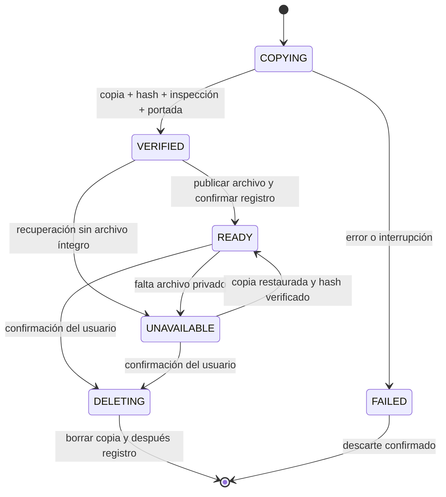

# Arquitectura implementada y decisiones — Fase 0

Fecha: 23/11/2026. Fuente de requisitos: `MASTER_PLAN.md` v1.0, conservado sin cambios.

## ADR-001 — Un módulo y separación lógica

Se implementa solo `:app`. Las capas se organizan dentro de `com.lectoria.app`:

- `presentation`: Compose, navegación y `LibraryViewModel`, estado expuesto con
  `StateFlow` y recogido mediante `collectAsStateWithLifecycle`.
- `domain`: modelos de libro/progreso y contratos de repositorios, documentos,
  narración y reproducción. No importa Android, Compose, Hilt ni adaptadores.
- `data`: reservado para Room, DataStore y archivos privados en Fase A.
- `engine/document`, `engine/narration`, `engine/playback`: responsabilidades
  reservadas para adaptadores de framework, documentadas sin implementaciones falsas.
- `core/designsystem`: tema oscuro fijo, tokens tormenta medianoche y tipografía.

Hilt genera el contenedor de Application/Activity y crea el ViewModel real. Aún no
se agregan módulos DI vacíos ni repositorios simulados. La UI inicial no consume
casos de uso porque no hay operaciones de negocio implementadas; se incorporarán
al conectar la biblioteca persistente. El dominio define sus contratos por adelantado.

La navegación mantiene una pila acotada con `launchSingleTop`, `popUpTo`, guardado
y restauración de estado; Atrás desde una pantalla secundaria vuelve a Biblioteca.
`Scaffold` maneja insets y los contenidos usan listas desplazables para pantallas
pequeñas y tamaños de fuente del sistema. Iconos decorativos sin descripción
duplicada; las pestañas tienen etiquetas y semántica de selección.

## ADR-002 — Matriz estable y reproducible

| Componente | Versión efectiva |
|---|---|
| JDK de build y pruebas / bytecode | Temurin 21.0.9+10 / Java y Kotlin 17 |
| Gradle | 8.13, Wrapper oficial generado desde distribución verificada |
| Android Gradle Plugin | 8.13.2 |
| Kotlin / plugin Compose | 2.2.21 / 2.2.21 |
| KSP | 2.2.21-2.0.4 |
| Hilt | 2.57.2 |
| Compose BOM | 2025.11.01 |
| Activity Compose / Core KTX | 1.11.0 / 1.17.0 |
| Lifecycle | 2.9.4 |
| Navigation Compose | 2.9.5 |
| AndroidX Hilt Compose | 1.3.0 |
| Coroutines | 1.10.2 |
| JUnit / Robolectric | 4.13.2 / 4.16 |
| minSdk / compileSdk / targetSdk | 26 / 36 / 36 |
| SDK Build-Tools | 36.0.0, fijado explícitamente |

Se eligió una combinación conservadora estable, con versiones exactas en
`gradle/libs.versions.toml`; no se pretende usar automáticamente la última versión
de cada componente. Kotlin y su compilador Compose comparten versión. Hilt usa KSP,
sin KAPT. AGP 8.13 requiere Gradle 8.13 y JDK 17 como mínimo; la compilación es la comprobación
efectiva de compatibilidad de los componentes que realmente se enlazan.

El entorno traía JDK 21 y SDK 36. Se descargó y verificó JDK 17 en tooling externo
al repositorio y se generó el primer APK Debug con él. Sin embargo, **Robolectric
4.16/API 36 exige Java 21**: al ejecutar la prueba de UI con Java 17 se obtuvo
`Android SDK 36 requires Java 21 (have Java 17)`. Esta incompatibilidad comprobada
justifica la excepción solicitada: se usa JDK 21 para build y pruebas, manteniendo
`sourceCompatibility`, `targetCompatibility` y `jvmTarget` en 17 y `minSdk=26`.
La CI también usa JDK 21. El Wrapper incluye checksum de distribución verificado:
`20f1b1176237254a6fc204d8434196fa11a4cfb387567519c61556e8710aed78`.

Referencias consultadas: metadata oficial de
[AGP](https://dl.google.com/dl/android/maven2/com/android/tools/build/gradle/maven-metadata.xml),
[Kotlin](https://repo.maven.apache.org/maven2/org/jetbrains/kotlin/kotlin-gradle-plugin/maven-metadata.xml),
[KSP](https://repo.maven.apache.org/maven2/com/google/devtools/ksp/symbol-processing-gradle-plugin/maven-metadata.xml),
[Hilt](https://repo.maven.apache.org/maven2/com/google/dagger/hilt-android/maven-metadata.xml)
y [Compose BOM](https://dl.google.com/dl/android/maven2/androidx/compose/compose-bom/maven-metadata.xml).

## ADR-003 — Readium y PDF se validan antes de integrarlos

Se confirmó la existencia del artefacto **Readium 3.4.0** en Maven Central. Su
[POM publicado](https://repo.maven.apache.org/maven2/org/readium/kotlin-toolkit/readium-shared/3.4.0/readium-shared-3.4.0.pom)
declara **Kotlin 2.4.20** y Coroutines **1.11.0**. Por eso no es correcto afirmar
compatibilidad de esa versión con el compilador Kotlin 2.2.21 de Fase 0.

Readium no se fija como dependencia ni se integra en esta fase: no se necesita
para mostrar estados vacíos y ampliaría el alcance. Antes de Fase B, el spike debe
resolver conjuntamente Kotlin/AGP/KSP/Hilt/Readium, actualizar esta matriz y probar
un EPUB sintético real. El `minSdk=26` sigue el requerimiento explícito de la sesión,
superior al mínimo de referencia del documento maestro; no sustituye el spike.

La documentación web de developer.android.com y readium.org estuvo bloqueada por
el proxy del entorno (HTTP 403); se pudo consultar Maven. No se realizó apertura
EPUB ni extracción PDF. No hay evidencia que permita declarar esas funciones listas.
La elección del extractor PDF y sus licencias sigue abierta. `PdfRenderer` no se
presenta como extractor textual.

## ADR-004 — Contratos honestos para posiciones y voz

`ReadingLocator` conserva el formato: locator EPUB opaco, página PDF o carácter TXT.
`TextLocator` identifica sección y carácter del texto extraído; `MediaPositionMs`
identifica tiempo de un archivo de audio. Sus constructores rechazan posiciones
negativas y ubicaciones vacías. El adaptador EPUB deberá validar su JSON real.

`NarrationEngine` distingue `LiveSpeech` de `AudioFile` y no promete pause/seek por
milisegundos. Solo `AudioPlaybackController` tiene `seekTo(MediaPositionMs)`.
La coordinación, audio focus, motores y caché se implementarán en sus fases.

## ADR-005 — Privacidad y alcance visual

El manifiesto no solicita Internet, almacenamiento general ni permisos de audio.
No hay clientes cloud, credenciales ni contenido de muestra. El backup de la app
se desactiva para no enviar futuros documentos privados al backup del sistema sin
una política explícita: `allowBackup=false`, `fullBackupContent=false` y reglas que
excluyen los dominios de cloud backup y device transfer en Android 12+. Revisar
exportación/respaldo local en su fase de producto; no se ensayaron transferencias físicas.

El tema usa las cinco referencias de color, superficies Glass discretas y texto
claro sobre fondos oscuros. La importación no tiene un botón inerte; lector,
reproductor y ajustes muestran «Pendiente de desarrollo». La única interacción
disponible es la navegación que realmente existe.

## Diferencias documentales resueltas

El prompt original sugiere `feature/fase0-fundamentos`; la solicitud de esta sesión
pide `feature/fase-0-fundamentos`. Se aplica la segunda, partiendo del commit inicial
`3007588`, que coincide con `origin/main`, sin modificar `main`. Los documentos
originales de alcance permanecen intactos; los estados actuales viven en los nuevos
documentos de seguimiento y en la actualización añadida al README.

## ADR-006 — Fase A: Room, archivos privados y recuperación

Se mantiene `:app` y la matriz de compilación existente. Se añaden **Room 2.8.3**
(runtime + procesador KSP; las extensiones Flow/suspend ya pertenecen al runtime)
y **DataStore Preferences 1.2.0**. Ambas versiones se verificaron como publicadas en
Google Maven y se validan mediante compilación/pruebas. No se añade WorkManager:
esta fase copia un documento seleccionado y reconcilia interrupciones al abrir
la biblioteca; no promete terminar importaciones en segundo plano tras un cierre.

`BookRepository` ahora devuelve `ImportOutcome.Imported` o `AlreadyPresent` y
expone libros e incidencias persistidas. Los casos de uso encapsulan importación,
observación/orden, reconciliación, eliminación y descarte de fallos. El ViewModel
expone carga, operación real en curso, mensaje, búsqueda, selección y confirmación.
Hilt enlaza implementaciones reales; ninguna pantalla consulta Room directamente.

La tabla `books` conserva metadata y estado. SHA-256 tiene índice único nullable:
las copias incompletas aún no tienen identidad de contenido. No se usa reemplazo
destructivo (`REPLACE`) para resolver duplicados ni `fallbackToDestructiveMigration`.
Esquema inicial versión 1 exportado en `app/schemas`; Fase 0 no tenía base de datos.
Un cambio futuro de versión requiere una migración explícita probada.

El proveedor SAF solo se abre para lectura. Los bytes se copian a
`filesDir/library/<UUID>/original.part`, con tamaño real limitado y SHA-256 durante
la copia. El nombre externo nunca decide una ruta privada. Tras inspeccionar y
guardar portada opcional, se persiste VERIFIED, se hace un movimiento atómico
dentro del directorio privado a `original.<formato>` y se confirma READY. Cada
archivo escrito se sincroniza antes de completar esa etapa. No hay una transacción
conjunta Room/filesystem; se toleran caídas a ambos lados del movimiento.

Al reiniciar, VERIFIED se completa solo si tamaño y hash coinciden. COPYING pasa a
FAILED y conserva su temporal hasta descarte confirmado. READY comprueba presencia,
lectura y tamaño; UNAVAILABLE conserva identidad y metadata, y exige hash para
volver a READY. No se promete detectar una modificación de igual longitud en cada
arranque; la validación al abrir para lectura pertenece a Fase B.

Los originales huérfanos en directorios UUID propios se inspeccionan y adoptan si
son válidos y únicos. Temporales y duplicados huérfanos quedan como incidencias;
directorios desconocidos se preservan. La reconciliación no barre originales válidos.
Las escrituras se serializan por un repositorio singleton y la unicidad también
se protege en SQLite. Se propaga cancelación de coroutines en lugar de convertirla
en un éxito o error ordinario.

Una eliminación confirmada persiste DELETING antes de tocar archivos. Se elimina
solo el directorio privado del UUID y luego la fila; un fallo puede reintentarse
al reiniciar porque conserva ese consentimiento. Nunca se elimina el documento
del proveedor SAF. La URI no se guarda ni se solicita un permiso persistente: una
copia importada deja de depender del acceso al proveedor.

## ADR-007 — Inspección acotada por formato

Límite inicial: **64 MiB por original**. Se comprueban tanto el tamaño declarado
como los bytes reales. Encabezado y extensión/MIME reconocidos deben concordar.

- **TXT:** recorrido completo con decodificador estricto. UTF-8, UTF-16 LE/BE con
  BOM y fallback Windows-1252 si UTF-8 es inválido. Se guarda la codificación;
  rechaza vacíos y controles binarios. No se carga todo el texto en memoria.
- **EPUB:** validación ZIP/CRC y metadata OPF con namespaces. Máximo 2000 entradas,
  16 MiB por entrada, 200 MiB expandidos y ratio 200:1 para entradas mayores de
  1 MiB. Rechaza rutas inseguras, entradas repetidas, DTD/entidades no resueltas,
  XML de profundidad mayor de 64 y más de 100 000 tokens. Se validan container,
  mimetype y referencias spine. Se detecta LCP/cifrado no compatible; la ofuscación
  de fuentes reconocida no se confunde con DRM de contenido. No extrae capítulos
  al filesystem ni sustituye a Readium o a EPUBCheck. OPF/container se limitan a
  2/1 MiB. Portadas JPEG/PNG de hasta 5 MiB y 16 megapíxeles se reducen a PNG de
  hasta 512 píxeles; SVG permanece sin vista previa en esta fase.
- **PDF:** encabezado y terminación, apertura con `PdfRenderer`, al menos una página
  y vista previa de primera página de hasta 384 × 512. No extrae texto, título ni
  autor del PDF; usa el nombre del archivo como título. Las contraseñas/protección
  detectadas dan error explícito. Su ejecución nativa requiere un Android real.

Readium y el extractor textual PDF siguen pendientes de Fase B. La limitación de
Kotlin de Readium 3.4.0 permanece documentada; esta inspección de importación no
impone actualizar toda la matriz antes de incorporar un lector completo.

## ADR-008 — Interacciones reales y preferencias

El selector ACTION_OPEN_DOCUMENT añade CATEGORY_OPENABLE y tipos EPUB/PDF/TXT,
incluyendo ZIP/octet-stream para proveedores que etiquetan genéricamente; el
inspector decide el formato admitido. Cancelar no modifica la biblioteca.

Las tarjetas abren detalles reales, no un lector simulado. La eliminación y el
descarte de importaciones piden confirmación. La búsqueda filtra título/autor y
el orden recientes/título se guarda en DataStore. Si falla una lectura de preferencias
por I/O, se usa el orden reciente sin sobrescribir el archivo de preferencias.
La biblioteca no necesita permisos generales de almacenamiento, Internet o audio.

Las nuevas acciones usan `LectorButton`/`LectorTextButton`: texto claro sobre
container alcanza 9.15:1 y highlight sobre surface 11.57:1. El azul primary sobre
surface no alcanza 4.5:1 para texto normal, por lo que se conserva como token de
acento y se usan los colores accesibles existentes para etiquetas/acciones.
